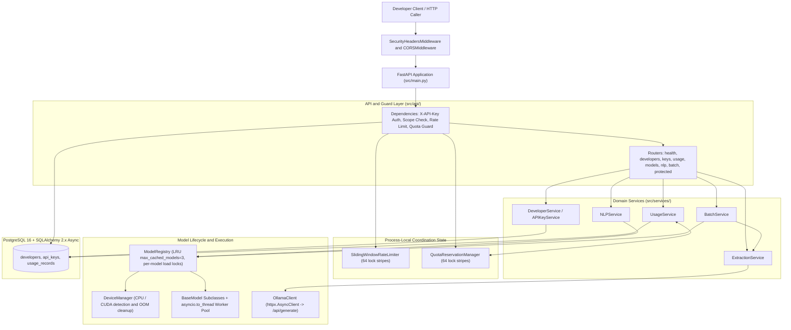
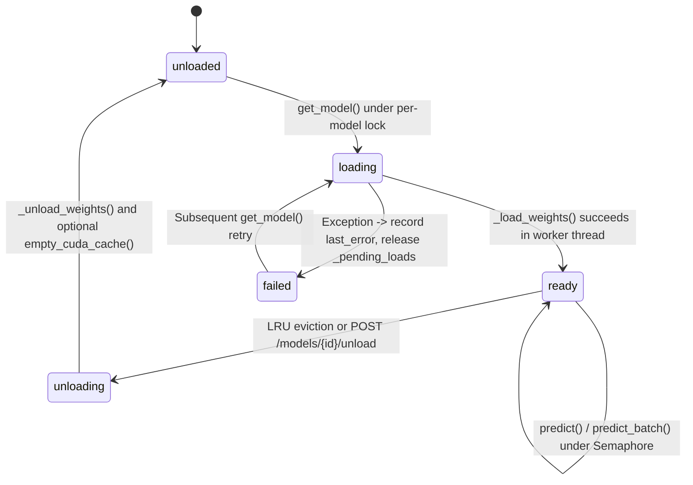
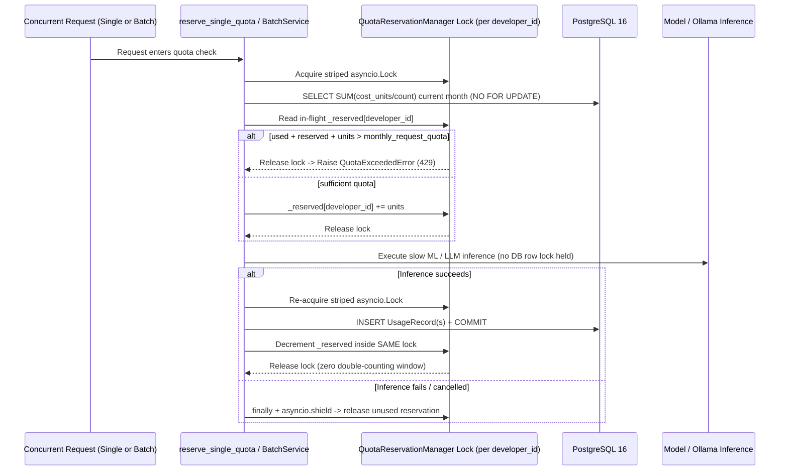

# NLPulse Architecture

NLPulse is an asynchronous, developer-facing FastAPI service combining local Hugging Face Transformers inference, optional Ollama generative structured extraction, multi-tenant API key authentication, sliding-window rate limiting, atomic quota reservation, and PostgreSQL usage metering inside a resource-bounded single-node runtime.

For high-level setup and API usage, return to the [README](../README.md). Detailed engineering decisions are recorded in the ADRs:
- [ADR-001: API-First Monolithic Architecture](./adr/001-api-first-monolithic-architecture.md)
- [ADR-002: Async SQLAlchemy 2.x and PostgreSQL 16 Architecture](./adr/002-async-sqlalchemy-and-postgresql-architecture.md)
- [ADR-003: Model Registry and Lifecycle Management](./adr/003-model-registry-and-lifecycle-management.md)
- [ADR-004: Local-First Optional Ollama Integration](./adr/004-local-first-optional-ollama-integration.md)
- [ADR-005: Batch Processing and Bounded Concurrency](./adr/005-batch-processing-and-bounded-concurrency.md)
- [ADR-006: Quota Reservation and Transaction Strategy](./adr/006-quota-reservation-and-transaction-strategy.md)
- [ADR-007: Single-Worker Deployment Boundary](./adr/007-single-worker-deployment-boundary.md)

---

## 1. System Overview



---

## 2. Request Lifecycle

1. **Ingress & Middleware (`src/main.py`):**
   - `CORSMiddleware` handles cross-origin preflight and origin headers configured via `Settings.CORS_ORIGINS`.
   - `SecurityHeadersMiddleware` stamps `X-Content-Type-Options: nosniff`, `X-Frame-Options: DENY`, `X-XSS-Protection: 1; mode=block`, and `Strict-Transport-Security` on every response, including error responses.
2. **Router Dispatch & Exception Translation:**
   - Domain exceptions subclassing `NLPulseException` map deterministically to JSON responses (`401`, `403`, `404`, `409`, `422`, `429` with `Retry-After`, `500`, `502`, `503`, `504`).
   - `SQLAlchemyError` translates to HTTP `503` (`"Database service temporarily unavailable."`) without exposing connection strings, SQL statements, or stack traces.
   - Any unhandled `Exception` logs with `exc_info=True` and returns a safe HTTP `500` (`"Internal server error."`).
3. **Dependency Chain & Teardown (`src/api/deps.py`, `src/db/session.py`):**
   - `get_db()` yields a request-scoped `AsyncSession` (`expire_on_commit=False`, `autoflush=False`), rolls back on unhandled exceptions, and closes on exit.
   - FastAPI's dependency cache shares that `AsyncSession` across auth, developer lookup, quota reservation, and the route handler within the request.
4. **Application Lifespan:**
   - Startup configures structured JSON/text logging (`src/core/logging.py`), initializes `DeviceManager` and `ModelRegistry`, and registers the five Hugging Face models (`_register_default_models`) for lazy loading.
   - Shutdown awaits `app.state.model_registry.unload_all()` to release model weights cleanly, then disposes the SQLAlchemy async `engine`.

---

## 3. Authentication & Authorization Flow

```mermaid
sequenceDiagram
    participant C as Client
    participant D as API Dependencies (deps.py)
    participant S as APIKeyService / DeveloperService
    participant RL as SlidingWindowRateLimiter
    participant DB as PostgreSQL 16

    C->>D: Request with X-API-Key header
    D->>S: authenticate_raw_key(raw_key)
    S->>S: sha256(raw_key)
    S->>DB: SELECT api_keys WHERE key_hash = :hash
    DB-->>S: APIKey row (or None -> 401)
    S->>S: Verify is_active, revoked_at is None, not expired
    S->>DB: Update last_used_at and commit
    D->>S: Check require_scopes(*allowed)
    Note right of D: "admin" or "*" satisfies all scopes; else require >= 1 match (403 on mismatch)
    D->>DB: Load active Developer row
    D->>RL: check(api_key.key_hash)
    RL-->>D: (allowed, retry_after) -> 429 + Retry-After if exceeded
```

- **Key Generation (`src/core/security.py`):** Raw keys use `nlp_live_<secrets.token_urlsafe(32)>`. Only `key_prefix` (first 16 characters) and the 64-character hexadecimal SHA-256 `key_hash` are persisted. Plaintext keys are returned strictly once on creation (`POST /api/v1/developers` or `POST /api/v1/keys`) and never stored or logged.
- **Public Registration Admission & Hardening (`src/api/routes/developers.py`, `src/api/deps.py`):** Public `POST /api/v1/developers` runs `check_registration_rate_limit` (`registration_rate_limiter`, `5` requests per `60s` per IP by default) before creating any DB records, returning `429` + `Retry-After` on excess requests. Direct peer IP (`request.client.host`) is used unless `peer_ip` matches `TRUSTED_PROXY_IPS`, in which case right-most untrusted `X-Forwarded-For` traversal prevents client spoofing. Public registration always forces `tier="free"` (`monthly_request_quota=1000`) and bootstrap capability scopes — never `admin`.
- **Non-Delegable Child Keys (`src/api/routes/keys.py`):** Non-empty scopes are mandatory (`min_length=1` and blank-string rejection in `APIKeyCreate`, plus explicit guard in `APIKeyService.create_key`). Non-`admin` callers can only delegate a subset of scopes held by their authorizing key.
- **Tenant Isolation:** Key listing, key revocation, developer profiles, and usage queries filter strictly by `developer_id` extracted from the authenticated `APIKey`, returning `404` when another tenant's `key_id` is targeted.

---

## 4. Individual NLP Inference Flow

All six individual NLP routes under `POST /api/v1/nlp/*` follow a consistent request guard pipeline:
1. `require_scopes(<task>:read, ..., nlp:read, analyze:read, admin)` (`extraction` also allows `generate:read`).
2. `check_rate_limit` against `api_key.key_hash`.
3. `reserve_single_quota` (`units=1`).
4. Route handler constructs `NLPService(session, registry)` or `ExtractionService(session, ollama_client)`.

Task-specific execution details:
- **Sentiment (`SentimentModel`):** Uses `transformers.pipeline("sentiment-analysis", top_k=None)`. Returns predicted label, confidence (`0.0..1.0`), and full class score distribution (`NLP_MAX_TEXT_LENGTH=5000`).
- **Named Entity Recognition (`NERModel`):** Uses `transformers.pipeline("ner", aggregation_strategy="simple")`. Normalizes inverted/negative offsets and falls back to `text[start:end]` slicing when token words omit text.
- **Zero-Shot Classification (`ZeroShotClassificationModel`):** `NLPService.validate_zero_shot_inputs` trims/deduplicates labels and caps requests at `25` unique labels (`<= 200` chars each) to prevent combinatorial NLI DoS. Evaluates softmax (`multi_label=False`) or independent scores (`multi_label=True`) sorted descending.
- **Keyword Extraction (`EmbeddingModel` + `nlp_utils.extract_candidate_ngrams`):** Generates n-grams (`1 <= min_n <= max_n <= 3`) using `ENGLISH_STOPWORDS` boundary filtering (`KEYWORD_MAX_CANDIDATES=100` max candidates, or caller-supplied `candidates`). Computes L2-normalized mean-pooled 384-d embeddings (`sentence-transformers/all-MiniLM-L6-v2`, capped at `256` tokens) for `[clean_text, *candidate_phrases]` in one forward pass, then ranks deterministically via `(-score, keyword)`.
- **Summarization (`SummarizationModel` + `nlp_utils.chunk_text_by_sentences`):** Accepts up to `10,000` characters (`5 <= min_length <= max_length <= 1000`). Documents exceeding `SUMMARIZATION_CHUNK_SIZE=1800` chars or `600` estimated/tokenizer tokens split along sentence/word boundaries, summarize chunk-by-chunk, and run bounded hierarchical consolidation (max `5` rounds, terminating early on single-chunk convergence or non-shrinking rounds). Meters `cost_units = len(initial_chunks)`.

---

## 5. Batch Inference Flow

All six batch endpoints (`POST /api/v1/nlp/batch/*`) decouple **envelope validation** from **per-item execution**:

| Capability | `execution_mode` | Execution Strategy | Failure & Fallback Behavior |
| :--- | :--- | :--- | :--- |
| `sentiment` | `batched_inference` | Shared `_run_text_micro_batch`: chunks valid items by `BATCH_INFERENCE_CHUNK_SIZE` (`8`) across `_run_bounded_workers` (`BATCH_MAX_CONCURRENCY=4`) calling `model.predict_batch` | Failed chunk falls back to per-item `model.predict` isolating offending inputs |
| `ner` | `batched_inference` | Shared `_run_text_micro_batch` calling `NERModel.predict_batch` | Failed chunk falls back to per-item `model.predict` |
| `classification` | `grouped_batched_inference` | Groups items by `(tuple(clean_labels), multi_label)`, chunks groups by `8`, runs `ZeroShotClassificationModel.predict_batch` | Failed group chunk falls back per item with original labels |
| `keywords` | `deduplicated_batched_embeddings` | Validates & extracts n-grams per item; deduplicates all docs and candidates into `unique_texts`; encodes in chunks (`max(8, BATCH_INFERENCE_CHUNK_SIZE * 4)`) | Items missing any failed chunk vector fall back to isolated per-item embedding |
| `summarization` | `bounded_concurrent` | Runs `min(N, BATCH_MAX_CONCURRENCY)` async workers invoking `NLPService.run_summarization_model` | Per-item exception caught and mapped into `BatchItemResult` |
| `extraction` | `bounded_concurrent` | Runs `min(N, BATCH_MAX_CONCURRENCY, BATCH_EXTRACTION_CONCURRENCY)` (`<= 2` default) workers invoking `ExtractionService.execute_extraction_inference` | Per-item schema/Ollama errors mapped to item status codes (`404`, `422`, `502`, `503`, `504`) |

- **Envelope limits:** Empty batches (`len(items) < 1`) or oversized batches (`len(items) > BATCH_MAX_SIZE`, default `20`) fail at Pydantic validation with HTTP `422`.
- **Order & ID preservation:** Output `results` strictly match submitted indices `0..N-1` and echo optional caller `id` values.

---

## 6. Model Lifecycle & Cache Management



1. **Lazy Initialization (`MODEL_ENABLE_WARMUP` reserved):** Startup registers metadata + factory callables without downloading Hugging Face weights. Note that `MODEL_ENABLE_WARMUP` is present in `Settings` and `.env.example` as a reserved flag, but `lifespan()` does not trigger warmup.
2. **Parallel Distinct Loads vs. Cache Bound (`src/services/model_registry.py`):**
   - Each `model_id` owns a dedicated `_loading_locks[model_id]`, so two requests for the *same* unloaded model load weights once while concurrent requests for *different* models load in parallel.
   - `_ensure_cache_capacity()` checks `len(_loaded_models) + len(_pending_loads)` under `_registry_lock`. If at `max_cached_models`, it selects the idle (`not m.is_busy()`) loaded model with oldest `last_used_at`, marks it in `_evicting_models`, and unloads it outside `_registry_lock`. If all slots are actively busy/pending, it raises `ModelResourceError` (HTTP `503`).
3. **Worker Thread Safety (`src/core/models/base.py`):**
   - `_run_worker()` acquires `asyncio.Semaphore(metadata.max_concurrency)` (default `2`), increments `_active_inferences`, and offloads synchronous PyTorch inference via `asyncio.to_thread(...)`.
   - Because asyncio cancellation cannot forcibly kill Python OS threads, `worker_task` is awaited via `asyncio.shield(worker_task)` and decrements `_active_inferences` / releases `_semaphore` solely inside `worker_task.add_done_callback(_cleanup_worker)`. This ensures a timed-out request returns HTTP `500` while preventing `ModelRegistry` from unloading a model whose worker thread is still executing.
4. **Device Selection (`src/core/device.py`):** `MODEL_DEVICE_PREFERENCE=auto` resolves `"cuda"` if `torch.cuda.is_available()` else `"cpu"`; explicit `"cuda"` without CUDA raises `DeviceUnavailableError` (`400`).

---

## 7. Database & Usage-Metering Flow

Three tables store persistent state (`migrations/versions/1687e8d000b1_initial_schema.py`):
- **`developers`**: Tenant identity, `tier`, `monthly_request_quota` (`>= 0` check constraint), `is_active`.
- **`api_keys`**: Hashed credentials (`key_hash` unique index), JSON `scopes`, lifecycle timestamps, composite index `(developer_id, is_active)`, `ON DELETE CASCADE` to `developers`.
- **`usage_records`**: Append-only invocation telemetry (`endpoint`, `method`, `status_code`, `input_character_count`, `latency_ms`, `cost_units`, `timestamp`), four SQL `CHECK` constraints, composite index `(developer_id, timestamp)`, `ON DELETE CASCADE` to `developers`, and `ON DELETE SET NULL` to `api_keys` (preserving historical billing audit trails when a key is revoked/deleted).

**Success-Only Metering:** Usage rows are inserted only after healthy inference (`200`). Validation failures, rate-limit rejections, Ollama outages, and cancelled batch items record zero `UsageRecord` rows.

---

## 8. Quota Reservation & Settlement



### Why This Replaced `SELECT ... FOR UPDATE` Across Inference
Prior to M8 hardening, quota checks acquired PostgreSQL `SELECT ... FOR UPDATE` row locks while settlement awaited `QuotaReservationManager`'s in-process asyncio lock. Under PostgreSQL 16 concurrency, Request A could hold the DB row lock during slow inference while Request B held the Python lock waiting for PostgreSQL — producing an **AB-BA deadlock** and starving pooled DB connections across slow model calls.

Moving mutual exclusion solely into the 64-stripe in-process `QuotaReservationManager` lock (`UsageService`) and performing both single-request settlement (`UsageService.record_usage` via `session.info["_quota_reservations"]`) and batch settlement (`UsageService.settle_batch_usage`) **atomically inside the same lock immediately after `commit()`** eliminated both the PostgreSQL AB-BA deadlock and the brief double-counting race window between DB commit and FastAPI dependency teardown.

---

## 9. Ollama Extraction Flow

1. `ExtractionService.validate_and_prepare()` validates non-whitespace input (`<= OLLAMA_MAX_INPUT_LENGTH=15000`), clamping temperature (`0.0..2.0`). Caller-supplied `schema_definition` payloads are verified pre-inference via recursive object/type checks and `jsonschema.Draft202012Validator.check_schema(...)`; simplified `fields` compile into nullable Draft 2020-12 properties (`[type, "null"]`) preserving `null` fallback for unstated values.
2. Builds a strictly grounded prompt instructing the local LLM (`OLLAMA_MODEL`, default `qwen2.5:3b`) to return pure JSON using `null` for unstated facts.
3. `OllamaClient.generate()` calls `POST {OLLAMA_BASE_URL}/api/generate` (`stream=False`, `format="json"`) using `httpx.AsyncClient`.
4. HTTP/transport errors map deterministically (`ConnectError`/`ConnectTimeout` -> `503 OllamaUnavailableError`; `TimeoutException` -> `504 OllamaTimeoutError`; missing model tag -> `404 OllamaModelNotFoundError`; other upstream status/non-JSON payloads -> `502 OllamaInferenceError` without echoing raw response payloads).
5. Post-generation processing strips Markdown code fences, parses JSON objects, strips disallowed extra keys when `additionalProperties` is `False`, normalizes contextual placeholders (`""`, `"null"`, `"none"`, `"n/a"`, `"unknown"`, `"not specified"`, `"not mentioned"` unless present in `source_text`), preserves invalid primitive values instead of silently converting them to `null`, and enforces **JSON Schema Draft 2020-12** (`Draft202012Validator` + built-in `FormatChecker`) raising `422 ExtractionValidationError` on violations. Neither logs nor client errors include raw model output, extracted values, or source document PII.
6. Meters `cost_units = max(1, round((total_tokens * EXTRACTION_COST_PER_1K_TOKENS) / 1000))`.

---

## 10. Error Handling & Cancellation Behavior

- **Upstream timeouts & hangs:** Hugging Face inference timeouts (`asyncio.wait_for(..., timeout=30s)`) shield the background worker thread so resource accounting stays exact; Ollama calls enforce `OLLAMA_TIMEOUT_SECONDS=60.0` (`504`).
- **Batch worker pool cancellation:** `_run_bounded_workers` catches `asyncio.CancelledError`, cancels all outstanding worker tasks, awaits `gather(..., return_exceptions=True)`, and re-raises so `BatchService._run_with_quota_guard`'s `finally` block releases reserved quota via `asyncio.shield`.
- **Single-request cancellation:** `reserve_single_quota` wraps fallback reservation release in `asyncio.shield`, preventing quota leaks on client disconnects before `record_usage`.
- **Safe failure surfaces:** Domain errors never leak raw SQL/file paths; unknown exceptions log full tracebacks server-side while returning generic JSON payloads to clients.

---

## 11. Deployment Assumptions

- **Single-Worker Process Model:** Production execution assumes one Uvicorn worker process (`uvicorn src.main:app --host 0.0.0.0 --port 8000`) connected to PostgreSQL 16 (and optionally a local Ollama daemon).
- **Database Provisioning:** Alembic migrations (`alembic upgrade head`) must be applied prior to serving traffic; the app does not auto-create tables at startup.
- **Model Cache Locality:** Hugging Face models download on first inference unless pre-populated in Hugging Face cache; Ollama models must be pulled separately (`ollama pull qwen2.5:3b`).

---

## 12. Security Boundaries & Design Tradeoffs

| Architectural Decision | Alternative Considered | Rationale & Actual Tradeoff |
| :--- | :--- | :--- |
| **FastAPI + async SQLAlchemy 2.x** | Sync Flask/Django or sync psycopg2 | Enables single-process async concurrency for I/O-bound Postgres + Ollama HTTP calls alongside `asyncio.to_thread` model workers without thread-per-request exhaustion. Tradeoff: requires strict async session lifecycle discipline (`expire_on_commit=False`). |
| **Centralized `ModelRegistry` with LRU** | Per-request model load or load all at startup | Loading Transformers weights per request adds multi-second latency; loading all 5 models eagerly risks exceeding 6 GB VRAM / 16 GB RAM. Tradeoff: first request per model incurs cold-start load delay (`MODEL_ENABLE_WARMUP` remains reserved). |
| **Decoupled optional `OllamaClient`** | Bundling `llama-cpp-python` or making Ollama mandatory | Keeps core container/env lean and allows M1–M5 + offline test suites to run without a local LLM daemon. Tradeoff: extraction requires running an external Ollama instance. |
| **Default mocked tests + opt-in real PG/HF suites** | Requiring live downloads & Postgres on every pytest run | Keeps `pytest` deterministic (~14s) in offline/CI environments while still exercising real HTTP routing, SQL constraints, and validation. Verified separately via opt-in `@pytest.mark.postgres` (PostgreSQL 16.15) and `@pytest.mark.smoke`. |
| **Process-local rate limit & quota reservation** | Adding Redis + distributed locking infrastructure | Zero extra infrastructure dependencies for single-node portfolio hosting and eliminates PostgreSQL deadlocks during inference. Tradeoff: `--workers > 1` breaks shared rate limits and cross-worker quota serialization. |
| **Model-level batching + bounded async workers** | Threading every request directly or naive serial loops | Sentiment/NER/Zero-Shot/Embeddings saturate PyTorch tensor batching cleanly, while memory-heavy chunked Summarization and network-bound Ollama Extraction must cap concurrent coroutines (`BATCH_MAX_CONCURRENCY=4`, `BATCH_EXTRACTION_CONCURRENCY=2`) to avoid OOM/saturation. |
